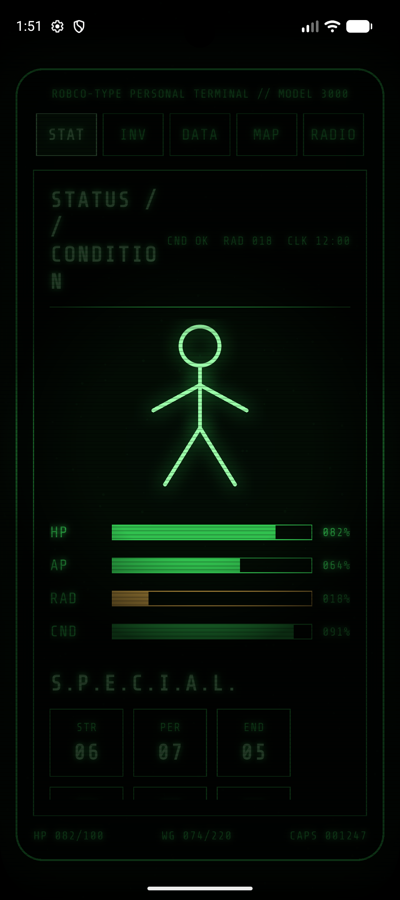
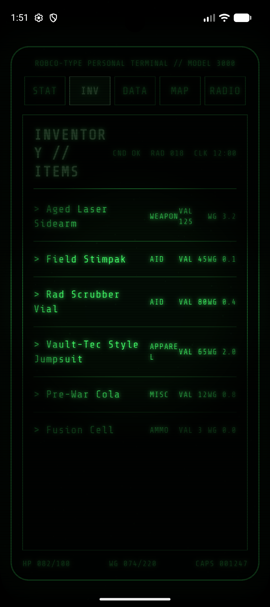
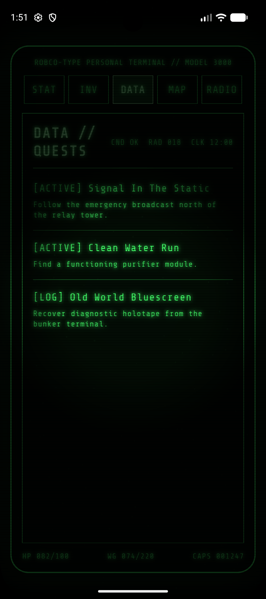
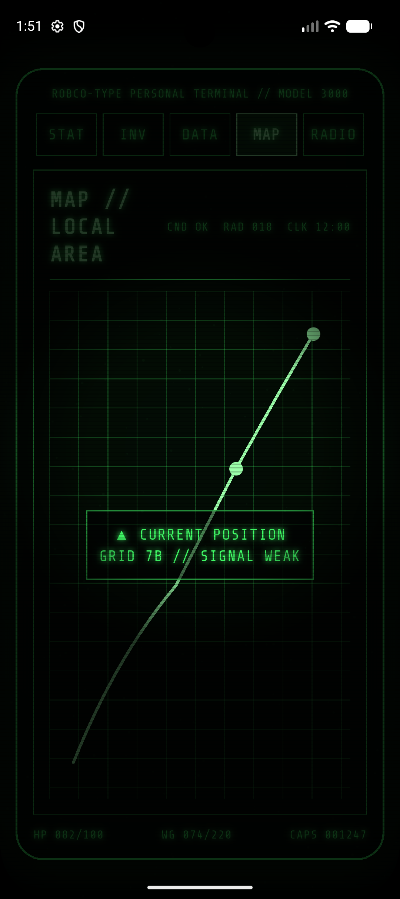
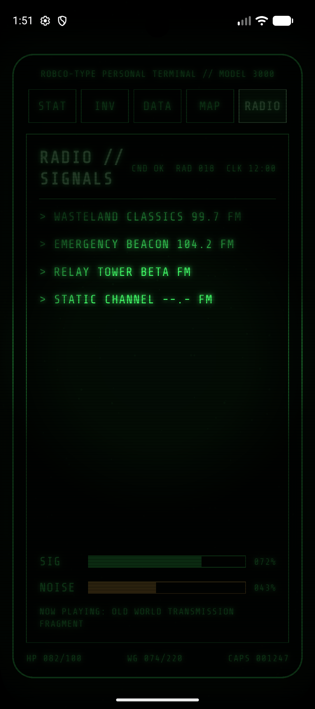

# PipBoy App

A Flutter prototype for a Fallout-inspired Pip-Boy style terminal UI.

> This project intentionally avoids official Fallout logos, names, copyrighted images, or extracted game assets. The retro feel is recreated entirely through original Flutter UI: monochrome green CRT glow, scanlines, grid map, terminal panels, item lists, character status and radio screens.

---

## Screenshots

| STAT | INV | DATA |
|:----:|:---:|:----:|
|  |  |  |

| MAP | RADIO |
|:---:|:-----:|
|  |  |

---

## Features

- **Five tabs** — STAT, INV, DATA, MAP and RADIO, switchable from the top tab bar
- **STAT screen** — S.P.E.C.I.A.L. attribute chips, HP / AP / RAD / CND progress bars, and a custom-painted character silhouette
- **INV screen** — Scrollable inventory list with item name, type, value and weight
- **DATA screen** — Quest log and note-style data entries
- **MAP screen** — Custom-painted grid map with location markers
- **RADIO screen** — Station list with a signal-strength indicator
- **CRT overlay** — Scanlines, green phosphor glow, noise and vignette rendered via `CustomPainter`
- **Terminal typography** — Share Tech Mono font throughout for an authentic terminal feel
- **Responsive mobile layout** — Designed for portrait phone screens

---

## Getting Started

### Prerequisites

- [Flutter SDK](https://docs.flutter.dev/get-started/install) ≥ 3.0
- Dart ≥ 3.0

### Run

```bash
flutter pub get
flutter run
```

---

## Project Structure

```text
lib/
  core/       Theme colors, text styles and sample data
  models/     Simple data models (inventory items, quests, …)
  painters/   CRT effect, map and character silhouette painters
  screens/    Five main Pip-Boy screens
  widgets/    Reusable terminal widgets (TerminalPanel, TerminalBar, StatusChip, …)
```

---

## Tech Stack

| Layer | Technology |
|-------|-----------|
| Framework | Flutter |
| Font | [Share Tech Mono](https://fonts.google.com/specimen/Share+Tech+Mono) via `google_fonts` |
| Rendering | Flutter `CustomPainter` for CRT effects and map |
| Platforms | Android · iOS · Web · macOS · Linux · Windows |

---

## License

This project is for personal / educational use. No official Fallout assets are included or required.
